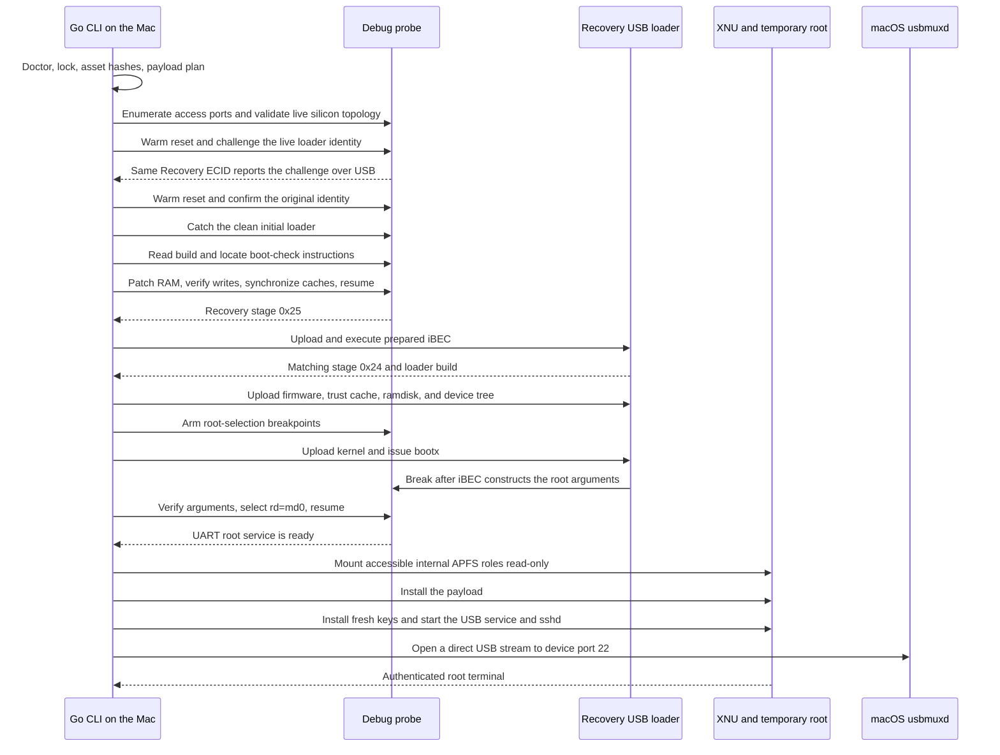
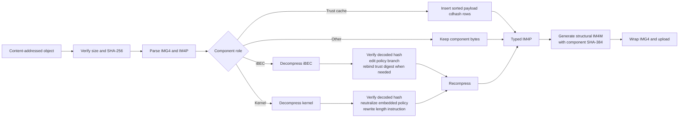

# 15 Plus kernel PoC

With the supported phone and debug probe attached, run:

```sh
go run . shell
```

If the temporary environment is already running, `shell` reconnects to it. Otherwise, the command moves the phone to Recovery, checks the phone and probe, analyzes the initial iBoot, obtains the required assets, boots XNU, and mounts internal storage read-only. It then waits for SSH and opens a root terminal. Type `exit` to close the terminal and release the USB, serial, SSH, and repository lock.

## Terms

- **Recovery mode:** the phone's bootloader screen and the USB protocol that receives restore components.
- **Debug probe:** hardware that controls and observes the application processor when the normal USB loader is unavailable.
- **Tethered boot:** a temporary environment that the Mac must start again after the phone restarts.
- **XNU:** Apple's operating-system kernel.
- **Payload:** software added to the temporary root filesystem.
- **SSH:** the encrypted terminal protocol used after boot.
- **Image4:** Apple's boot-object format. An **IM4P** holds one typed component, an **IM4M** holds its policy, and an **IMG4** envelope joins them.
- **Personalized ticket:** Apple-signed authorization tied to a device and nonce. This PoC does not use one.
- **External asset cache:** the ignored `.cache/` directory that holds firmware, prepared components, keys, logs, and temporary files.

## What is patched

- **Initial iBoot checks:** the CLI finds the Image4 policy and signature-failure paths, checks their original instructions, and patches them in RAM.
- **Runtime iBEC checks:** the CLI redirects the policy-failure branch to its decoded success path. It also updates iBEC's trust-cache digest for the cache used in that boot.
- **Kernel Image4 policy:** the CLI removes device-bound ticket fields from the kernel's embedded policy. It finds and updates the ARM64 instruction that supplies the policy length.
- **AMFI and executable trust:** the CLI checks arm64 and arm64e payloads, signs compatible unsigned files, and adds their cdhashes to the temporary trust cache.
- **TXM and SPTM handoff:** the CLI checks and uploads the matching TXM and SPTM components. It does not patch their binaries.
- **Root and boot arguments:** the CLI finds iBEC's root-selection state and changes it to use the generated ramdisk with serial debugging.
- **Temporary result:** reset removes the patches, trust-cache entries, payload, root filesystem, SSH service, and keys. Installed storage remains unchanged.

## Requirements and supported build

- iPhone 15 Plus `d38ap`.
- `CPID 0x8120`, `BDID 0x0a`, and `CPFM 0x00`. The CLI reads CPRV and SCEP but does not require fixed values.
- The iOS 26.3 build `23D127` runtime listed in `assets.json` and `bootstrap.json`.
- The supported debug-probe model. `doctor` finds its serial number and UART, then tests the protocol and target operations used during boot.
- Apple silicon macOS and Go 1.26.9 or newer.

The CLI reads the ECID from USB so each step stays bound to the same phone. It does not place the ECID in a boot policy and needs no device-specific authorization material. The installed iBoot may differ from the runtime iBEC. If a stored adapter matches the live bytes, the CLI uses it. Otherwise, the ARM64 analyzer must find the full set of boot-check instructions before the CLI writes memory.

Go code implements Recovery USB, probe USB, serial transport, Image4 composition, LZFSE compression, Mach-O checks and signing, usbmux framing, and SSH. The program runs no host command-line tools. It calls the macOS IOKit, CoreFoundation, and Compression frameworks directly and connects to the stock `usbmuxd` socket. Runtime checks cover each macOS facility. The command needs no Homebrew package, Python, Make, shell script, C compiler, Cgo, separate daemon, environment variable, or path argument.

To build a standalone executable:

```sh
go build -mod=vendor -o 15-plus-kernel-poc .
./15-plus-kernel-poc shell
```

## Commands

| Command | Behavior |
| --- | --- |
| `go run . shell` | Reconnect, boot from Recovery, or reset to Recovery and boot as needed, then open a terminal. |
| `go run . exec -- uname -a` | Reconnect or boot as needed, then run one argument-safe command through SSH. |
| `go run . payload list` | List the base payload and user additions separately. |
| `go run . payload add FILE` | Add a compatible executable as `/usr/local/bin/FILE`. |
| `go run . payload add FILE --dest /usr/local/bin/NAME` | Select its destination. |
| `go run . assets fetch` | Fetch and verify public Apple assets. |
| `go run . assets import bootstrap DIR` | Import the prepared, board-portable runtime objects. |
| `go run . doctor` | Validate the Mac, phone, Recovery USB, and probe identities. |
| `go run . reset` | Warm-reset a running target and verify persistent Recovery. |

## Assets and cache

The repository does not contain firmware images. The CLI downloads public firmware over HTTPS from the Apple URLs in `assets.json`. The manifest records each ZIP member's archive size, extracted size, SHA-256, role, and compatibility. Redirects must use TLS. The CLI verifies the bytes before placing them in the content-addressed cache.

`boot.json` lists the firmware uploads in order for the selected runtime. Before opening the phone, the CLI rejects duplicate roles, missing images, unknown commands, and profile mismatches.

`bootstrap.json` records the hashes of the prepared loader, kernel, ramdisk, SPTM, TXM, device tree, and trust cache. The repository does not contain these Apple-derived objects. They contain no ECID, nonce, ticket, board secret, or reusable SSH identity. The program adapts the installed iBoot, then boots the runtime named in the manifest. The installed OS and iBoot do not select the payload.

On a fresh Mac, import the prepared set if `shell` reports one of these hashes missing:

```sh
go run . assets import bootstrap /path/to/bootstrap
```

The directory needs only `objects/<sha256>` for the entries in `bootstrap.json`. The importer ignores supplied descriptors and validates the objects against the tracked manifest. Public inputs can be prefetched with:

```sh
go run . assets fetch
```

The ignored `.cache/` directory holds large images, generated keys, payload additions, captures, and logs. The CLI generates SSH client and host keys for the detected ECID and installs them in the temporary environment.

## Payload and internal storage

Add an iOS command for the phone’s Bash environment with:

```sh
go run . payload add /path/to/tool --dest /usr/local/bin/tool
```

Omit `--dest` to use the source filename under `/usr/local/bin/`. The command accepts thin, unencrypted iOS arm64 and arm64e executables with a minimum OS no newer than the selected runtime, currently iOS 26.3. The CLI verifies existing SHA-1 or SHA-256 code pages. It can sign an unsigned Mach-O when the reserved header padding can hold `LC_CODE_SIGNATURE`. The CLI then adds the file's cdhash to the temporary trust cache. It also checks the destination, collisions, permissions, hashes, and the 64 MiB additions limit.

`payload add` does not accept shell scripts. Built-in scripts are tracked in `commands/` and embedded during `go build`. The base command pack contains `ls`, `whoami`, `ps`, `env`, `printenv`, `id`, `w`, `which`, `clear`, `hostname`, `basename`, `dirname`, `head`, `grep`, `find`, `uname`, and `storage`. Run `commands` on the phone to list the installed commands.

After XNU starts, the CLI reads `AppleAPFSVolume` records from the device registry. Each record must name one valid device. The CLI recognizes System, Data, xART, Baseband data, Installer, Hardware, Preboot, and Update. It mounts each present role with `rdonly,nobrowse` below `/mnt/iphone/` and checks the result against the mount table.

The CLI does not guess missing roles, slice numbers, or property order. It reports unknown roles and leaves them unmounted until the code defines a safe path. It also skips volumes that need unavailable SEP-backed keys. Data is commonly such a volume. The shell remains usable, and `/mnt/iphone/system` exposes the installed system.

## Boot process

Each transport handoff has a timeout. Before continuing, the CLI checks the observed build, stage, or readiness marker.



## Boot checks and patches

The CLI builds file changes in host memory and uploads them for one boot. It does not modify cached source objects or internal phone volumes.



Before editing a file-backed instruction, the CLI checks the full decoded SHA-256, the original bytes, replacement length, bounds, and overlap. Before writing the live loader, it checks the entry block, build string, distant guard words, and original instruction. It reads back every write. If preparation fails while the core is halted, the CLI restores prior loader writes before resuming the core.

The generated IM4M contains the component type, SHA-384, CPID, and BDID. It contains no device ECID, nonce, key, certificate, or usable signature. The loader patches accept this policy through the component path. The kernel policy keeps public component digests and compatibility fields. It removes device fields, clears the nonce and signature fields, and uses an empty certificate sequence. The boot therefore needs no personalized ticket.

### Initial loader

The analyzer looks for five result pairs and the nearby policy and signature-result checks. In each pair, it changes `MOV Xn, X0` to `MOV Xn, XZR`. It also changes the following `CBZ W0, target` to an unconditional branch to the decoded target. The CLI replaces conditional policy and signature-result failures with `NOP`. The current pattern produces 17 checked instruction writes. The older exact adapter uses 16 checked writes. Reset removes every write because they exist only in loader RAM.

Before either path changes a boot-check instruction, the CLI changes one byte in the halted loader's build string. Recovery USB must report the changed string from the same ECID. The CLI then resets the phone and confirms that the original build string returns. This reversible check confirms that the probe and Recovery USB refer to the same board.

For a known loader, the CLI first tests an adapter that stores the entry point, build string, distant guards, and original instructions as image-relative offsets. If any byte differs, the CLI uses the Go analyzer. The analyzer reads target memory without changing it:

1. Derive the live image base from the caught entry PC and verify that it lies in the selected `t8120` executable range.
2. Grow a read-only snapshot within the CPID SRAM range until the patch plan remains unchanged after reading another chunk. Stop after three minutes. Cache different byte sequences separately even when they contain the same build string. Before using a cached snapshot, check its range and every selected instruction against halted memory.
3. Normalize only PC-relative and branch-distance fields while retaining opcodes, required register roles, conditions, constants, and neighboring data flow.
4. Require all patch roles in one compact control-flow neighborhood. Ignore unrelated matches elsewhere. Stop if two neighborhoods contain the full pattern. Follow the authenticated callback and its `W0` failure branch to find the signature check; do not search for a fixed digest or address.
5. Recompute every unconditional branch from the matched `CBZ` target rather than copying an address or displacement, and require the sites to form the expected control-flow neighborhoods.
6. Re-read every original instruction, write and read back each replacement, synchronize instruction/data caches, resume, and require the same observed stage `0x25` loader identity.

If the analyzer finds no full pattern or finds more than one, it stops before the first write. It saves the read-only code window under ignored `.cache/loader-analysis/`. If a later step fails while the core is halted, the CLI restores prior writes before resuming.

### Runtime iBEC and trust cache

The selected profile records the full decoded iBEC hash. After checking that hash, the CLI finds one policy continuation from the normalized ARM64 data flow. It decodes the destination of the matched `CBZ W0` and builds an unconditional branch to that destination. Source code contains no runtime patch address or branch displacement.

For each added executable, the CLI inserts the checked 20-byte cdhash in sorted order and removes duplicates. It preserves trust-cache formats 0, 1, and 2 by reading the row width and suffix from the header. The CLI finds one copy of the original trust-cache IM4P SHA-384 in decoded iBEC and replaces it with the new IM4P SHA-384.

### Kernel policy

The CLI first checks the full decoded kernel hash against the runtime profile. It then finds a valid embedded IM4M and the one nearby ARM64 instruction that loads the DER length into `X4`. The CLI rebuilds the policy, clears the unused bytes in its span, and writes the new length into that instruction. A runtime profile stores content hashes and policy rules, while the code derives offsets.

### Temporary root selection

The CLI finds one or two root-construction paths from normalized ARM64 data flow in the checked iBEC. It calculates their addresses from the loader base read from the phone. Before setting each hardware breakpoint, it checks the address again.

When a breakpoint fires, the CLI checks the program counter and reads the owner from `X19`. The owner must lie in the executable SRAM range. Within a bounded window, the CLI requires one printable, NUL-terminated prefix of the boot arguments it supplied. Those bytes reveal the field offset and writable length. Any extra bytes must be zero. The CLI writes `-v rd=md0 serial=3 debug=0x14e`, disables all root breakpoints, and resumes. Source code contains no owner address, structure offset, field capacity, or device-tree address.

## Compatibility model and extending it

The program separates the installed board state from the runtime it boots:

| Layer | How it is checked |
| --- | --- |
| Device family | Recovery must report `CPID 8120`, `BDID 0A`, and `CPFM 00`, which identify the `iPhone15,5`/`d38ap` family. ECID, CPRV, and SCEP do not select a profile. |
| Debug probe | USB identity selects the probe model. The CLI then tests framing, both protocol channels, clock control, discovered DP/AP roles, target routing, memory reads, and reset. IOKit binds the probe's USB serial to its channel-zero UART. Bulk transfers can use smaller chunks after an error; four-byte and atomic eight-byte accesses keep their required widths. |
| Silicon | `profile.go` selects the `t8120` address ranges from CPID. The probe reads access-port ID registers to find port roles. Before any loader write, `doctor` reads the boot-mode, debug-status, and wrapper registers. |
| Installed initial loader | The CLI reads the build from Recovery and halted RAM. It uses a stored adapter while all original bytes match. Otherwise, the loader must pass the instruction and unique-match checks in `loader_analyzer.go`. |
| Runtime | `profile.go` selects one tested iBEC and kernel. `assets.json` and `bootstrap.json` bind files by size and SHA-256. `boot.json` gives their upload order. The CLI derives policy sites, root paths, owner-field layout, trust-cache format, payload OS limit, and transport endpoints. |

The installed iBoot does not select the kernel, SPTM, TXM, ramdisk, or firmware set. If an unfamiliar loader retains the supported control flow, `shell` derives its patch transaction. Physical tests covered the stored `iBoot-8737.0.0.101.5` adapter and two loaders analyzed without version-specific offsets: `iBoot-9275.0.0.101.2` and `iBoot-9275.0.0.101.11`. The CLI stops before writing when the compiler output or boot-check flow does not match.

To support another loader pattern, update the normalized instruction relationships in `loader_analyzer.go`. Test them with an ignored loader snapshot, then verify the stage transition on hardware. Do not add an adapter that identifies sites by address alone.

To change the iOS runtime, add a `runtimeProfile` and its matching `d38ap` restore identity. Update the public-asset manifest, prepared-object manifest, and `boot.json`. Then test the iBEC instruction pattern, kernel policy schema, trust-cache format and binding, root-construction pattern, and physical boot. Store hashes and instruction rules in the profile; derive addresses and branch targets at runtime.

## Expected milestones and effects

1. Supported Recovery family, observed loader build, live silicon topology, probe protocol capabilities, and exclusive lock.
2. Asset verification, kernel-policy reconstruction, and payload trust composition.
3. Reversible probe/Recovery board binding, initial-loader reset catch, access-port discovery, adapter or ARM64 instruction analysis, checked RAM writes, cache synchronization, and resume.
4. Matching iBEC and verified firmware uploads. The iBEC execution request uses a visible wall-clock timeout and is retried only while the same ECID, initial stage, and live loader build remain present; upload and patch writes are not repeated.
5. Root-selection breakpoints and temporary ramdisk selection.
6. XNU and serial root-service readiness.
7. Every accessible internal APFS role mounted and verified read-only below `/mnt/iphone`; key-locked roles are named and skipped.
8. Payload and fresh SSH identity installation.
9. Authenticated SSH readiness and the terminal.

Every wait has a deadline and prints its latest observation. Downloads and large uploads show byte progress. Interactive host progress is colored; redirected output is plain, and `NO_COLOR=1` disables color.

The CLI saves `auto-boot=false`, so an ordinary restart returns to Recovery. Loader and kernel changes, generated policies, the ramdisk root, payload files, trust-cache entries, and internal mounts last for one boot. Cached objects, keys, payload additions, and logs remain in `.cache/` on the Mac. The program installs no host daemon, launch item, kernel extension, or package-manager file.

## Interruption and recovery

Ctrl-C cancels waits and I/O. The cleanup path closes Recovery, debug, serial, and SSH handles; restores terminal and UART settings; resumes a halted core; and releases the repository lock. The program creates no forwarding process or listening TCP port.

The phone may continue running if interruption occurs after `bootx`. Run `go run . reset`. The CLI first asks the root service to reboot. If the service is unavailable, it uses the probe reset. In Recovery, it saves `auto-boot=false`, restarts Recovery, and checks USB detach, reattach, stage, board identity, and loader build. If the probe reaches the initial loader without Recovery USB, the CLI catches and resumes the unmodified loader. Use the manual button sequence when both reset paths fail.

## Troubleshooting

**Unsupported device.** Run `go run . doctor`. It reports CPID, CPRV, BDID, CPFM, SCEP, Recovery stage, loader, silicon-topology, and probe failures. Disconnect other Recovery phones and use a `d38ap` CPFM00 iPhone 15 Plus.

**Initial-loader analysis failed.** The error names the missing or ambiguous instruction pattern and the snapshot saved in `.cache/loader-analysis/`. The CLI stopped before writing an instruction. Supporting the build requires another reviewed pattern in `loader_analyzer.go`; adding its version to a list is insufficient.

**Missing prepared component.** Run `go run . assets import bootstrap /path/to/bootstrap`. The error names the missing role and SHA-256. A ticket or board key will not satisfy this requirement.

**USB ownership.** Close Finder restore dialogs, Apple Configurator, and other restore/debug sessions. The repository lock detects another CLI instance; an exclusive-open error indicates another USB owner.

**Timeout.** Use the last milestone to identify the stalled phase, run `go run . reset`, and retry. Reconnect the phone and probe directly if reset cannot reach the target. Raw logs are in `.cache/logs/`.

**Encrypted APFS role skipped.** The CLI still tries every other role. An unavailable-volume-keys message means the temporary environment did not establish the phone's SEP-backed key service. The message does not indicate a wrong slice number or mount path. The shell remains available and leaves the locked role unchanged.

**SSH failure.** Wait for the root-service milestone. A host-key mismatch means the temporary service did not start with the locally generated key. Reset and rerun `shell`. If usbmux cannot find the recorded ECID, reconnect the phone cable.

## What can be reproduced

The source and vendored Go modules build offline. The CLI can reproduce public inputs while their pinned Apple URLs remain available. Hashes identify the prepared bootstrap objects across supported boards. The repository cannot derive the prepared loader, kernel, APFS root, SPTM, and TXM set from stock firmware. A fresh cache must import those objects from an authorized copy.

Physical tests booted XNU and reached authenticated SSH from the `iBoot-8737.0.0.101.5` adapter and from analyzed `iBoot-9275.0.0.101.2` and `iBoot-9275.0.0.101.11` loaders. For each 9275 build, the CLI derived the same 17-write pattern from live code, including the authenticated signature-result path. Another loader must pass the same topology and instruction-pattern checks. An `iBoot-*` build string alone does not grant support.

The PoC supports the `d38ap` CPFM00 family and the runtime profile listed above. A different admission flow or runtime needs the extension work described above. The environment lasts for one boot and is not an installation.

The source code is available under the [MIT License](LICENSE). Vendored modules retain their upstream license files.
